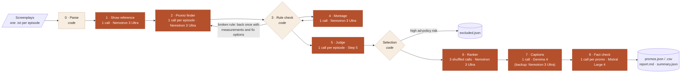
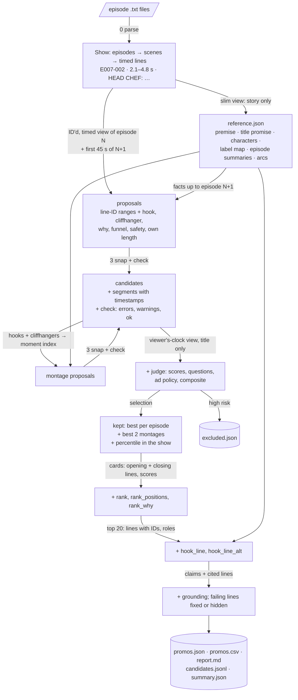
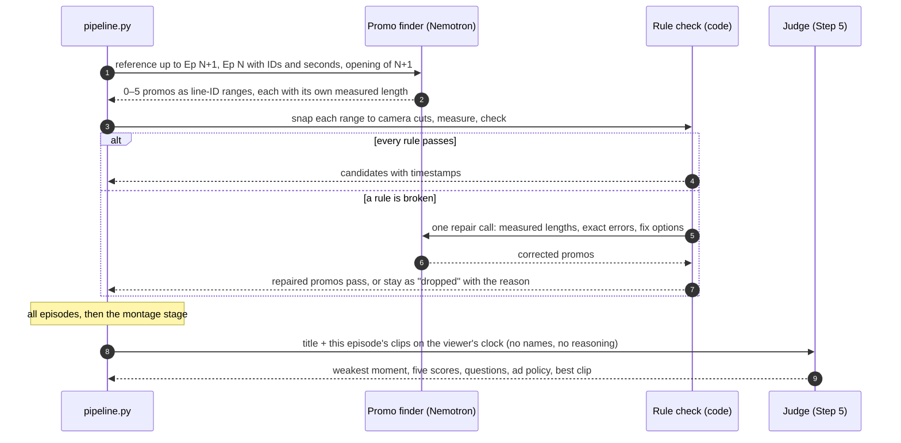
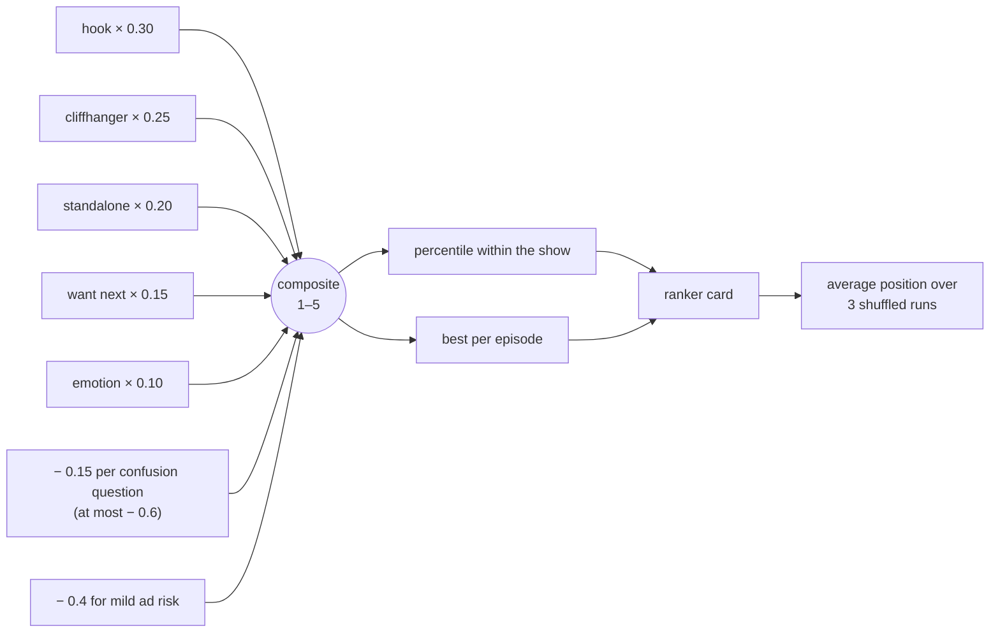
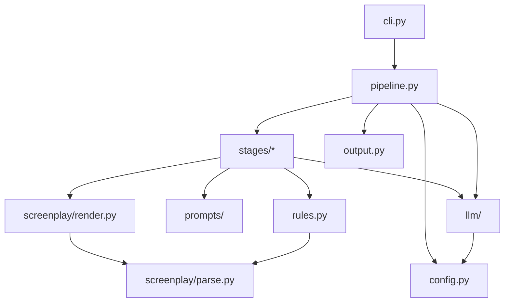
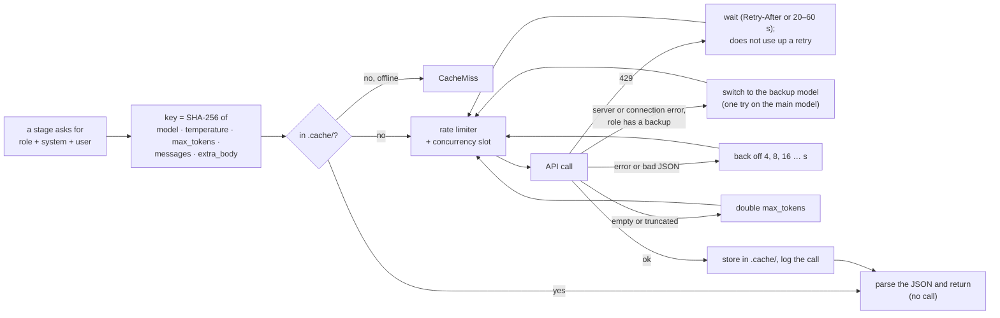

# Thumbstop Engine

**Finds the best promos in a microdrama, straight from its screenplay.**

Thumbstop Engine reads a folder of episode screenplays (one show) and finds the clips worth posting as ads on TikTok, Reels and Shorts. A good promo:

- is **20–60 seconds** long;
- **stops a scroller in the first 3 seconds** (the hook);
- **ends on a cliffhanger**, before anything is resolved;
- **makes sense to someone who has never seen the show**.

It then ranks every promo by which to post first, and writes a fact-checked line of ad copy for the top ones.

For every promo you get:

| | |
|---|---|
| **Where** | the episode and exact start and end timestamps of every segment, in play order |
| **Hook** | what the viewer sees and hears in the first 3 seconds |
| **Cliffhanger** | the moment it cuts away |
| **Why** | one line on why it works, and one on why it is ranked where it is |
| **Scores** | hook, cliffhanger, standalone sense, emotion and "want the next episode", each 1–5 from a blind judge, plus where the clip stands within the whole show |
| **Caption** | an optional one-line ad caption (and an alternative), every claim checked against the script |
| **Checks** | the rule checks it passed, its ad-policy rating, and any warnings for the editor |

Built for the Kuku AI Generalist Assignment (Problem 1, "Find the Promos"). The screenplays used to develop it are Kuku's confidential content and are **not** in this repository; every example below is invented.

---

## Contents

1. [Quick start](#1-quick-start)
2. [The input](#2-the-input)
3. [How it works](#3-how-it-works)
4. [The data path: what passes into what](#4-the-data-path-what-passes-into-what)
5. [The stages in detail](#5-the-stages-in-detail)
6. [How a promo is scored and ranked](#6-how-a-promo-is-scored-and-ranked)
7. [Models](#7-models)
8. [The outputs](#8-the-outputs)
9. [Repository structure](#9-repository-structure)
10. [Configuration](#10-configuration)
11. [Calls, cache, rate limits and run modes](#11-calls-cache-rate-limits-and-run-modes)
12. [Using it from Python](#12-using-it-from-python)
13. [Tests](#13-tests)
14. [Cost, time and scale](#14-cost-time-and-scale)
15. [Results on the assignment show](#15-results-on-the-assignment-show)
16. [Where it falls short](#16-where-it-falls-short)

---

## 1. Quick start

```bash
git clone https://github.com/sh-yamm/Thumbstop-Engine.git
cd Thumbstop-Engine
pip install -r requirements.txt            # openai, PyYAML, pytest; Python 3.10+
cp .env.example .env                       # then put your key in .env (free key: build.nvidia.com)

python -m thumbstop --show "path/to/show folder" --out outputs/myshow
```

Common variations:

```bash
python -m thumbstop --show "path/to/show" --out outputs/first10 --episodes 1-10    # part of a show
python -m thumbstop --show "path/to/show" --out outputs/quick --no-montage --top 5   # skip montages, caption 5
python -m thumbstop --show "path/to/show" --out outputs/replay --offline           # rebuild from the cache: no key, no calls
python -m thumbstop --show "path/to/show" --out outputs/live --fresh               # ignore the cache: every call is real
python -m pytest -q                                                                 # offline tests with a fake model
```

| Flag | Meaning | Default |
|---|---|---|
| `--show` | folder with one `.txt` screenplay per episode | required |
| `--out` | output folder | `outputs/run` |
| `--title` | show title, shown to the models | the folder name |
| `--episodes` | `1-10`, `1,5,12-14`, … | all |
| `--no-montage` | skip the cross-episode montage stage | montages on |
| `--top N` | write captions for the top N promos | `caption_top_k` in config (20) |
| `--workers N` | episodes handled in parallel | 8 |
| `--config` | another config file | `config.yaml` |
| `--offline` / `--fresh` | cache only / no cache (see [§11](#11-calls-cache-rate-limits-and-run-modes)) | normal |

The run prints one line per stage as it finishes. This is the assignment show, rebuilt offline from the cache (a live run prints real minutes on the last line):

```
[parse] 50 episodes; finding promos in 50
[reference] {'labels_total': 64, 'labels_unmapped': [], 'episodes_summarised': 50, 'episodes_total': 50}
[promo_finder] 145 proposals from 50 episodes
[montage] 11 montage proposals
[rule_check] 156 candidates, 138 pass the rules
[judge] 49 groups judged; 1 excluded (high ad-policy risk)
[selection] 48 kept (best 1 per episode, 2 montages)
[rank] 48 promos ranked
[captions] captions written for the top 20
[fact_check] 20 of 20 promos have a checked caption
[done] 48 promos ranked, 20 captioned, in 0.0 min
```

---

## 2. The input

A show is a folder of plain-text screenplays, one file per episode, in the format of the assignment's input pack. Every line of the screenplay (camera shot, action, sound effect or spoken line) carries its own start and end time on the episode's clock:

```text
EPISODE NUMBER: Episode 7
EPISODE LOGLINE: The new cook is accused of poisoning the guest of honour.
CONTINUITY NOTES: Night service; the kitchen is still flooded from Episode 6.

SCENE 01
Scene heading: INT. RESTAURANT KITCHEN - NIGHT
Scene start: 00:00.00
Scene end: 00:41.20

**CAMERA:**
Start: (00:00.00) | End: (00:02.10)
Close on a shattered plate.

**HEAD CHEF (Furious):**
Start: (00:02.10) | End: (00:04.80)
Who plated table nine?

**THE NEW COOK (Off-screen) (Shaking):**
Start: (00:04.80) | End: (00:06.30)
I did. But I never touched the sauce.
```

`CAMERA`, `ACTION` and `SOUND FX` are directions; any other label is a speaker. Parentheses after a speaker hold emotion or delivery tags; `Off-screen`, `O.S.` and `V.O.` mark a voice that is not on screen.

**Stage 0 (code) turns each file into an `Episode`** with numbered lines:

| Field | Example | Notes |
|---|---|---|
| `id` | `E007-002` | episode 7, line 2. **Every later stage refers to moments by these IDs** |
| `kind` | `dialogue` | `dialogue`, `action`, `sfx` or `camera` |
| `speaker` | `HEAD CHEF` | base label; screenplay labels are inconsistent, so stage 1 maps them to characters |
| `tags` | `["Furious"]` | emotion and delivery tags |
| `offscreen` | `false` | |
| `start`, `end` | `2.1`, `4.8` | seconds on the episode's clock |
| `scene` | `1` | |

Each episode also gets its **cut points**: the start of every camera shot and scene. Those are the only places a promo may start or end.

---

## 3. How it works



**Three principles shape the whole design:**

1. **Models choose moments; code owns the timeline.** Models only ever name line IDs (`E007-002`). Code turns IDs into timestamps, snaps them to camera cuts, and measures every rule. A model cannot invent a timestamp or cut a line in half.
2. **Nobody grades their own work.** The judge is a different model family from the promo finder and sees only what a stranger would see: the show title and the clip. The fact checker is a different family from the caption writer.
3. **Each model sees only what its job needs.** The same screenplay is rendered differently for each stage ([§5](#stage-0--parse-code)), which keeps calls short enough for the free tier and keeps the judge blind.

| | Stage | Who | Calls for a 50-episode show |
|---|---|---|---|
| 0 | Parse | code | 0 |
| 1 | Show reference | Nemotron 3 Ultra | 1 |
| 2 | Promo finder | Nemotron 3 Ultra | 50 |
| 3 | Rule check and repair | code, plus one repair call for each episode with a failing promo | about 12 |
| 4 | Montage | Nemotron 3 Ultra | 1 |
| 5 | Judge | Step 5 | about 50 (one per episode, one for the montages) |
| – | Selection | code | 0 |
| 6 | Ranker | Nemotron 3 Ultra | 3 |
| 7 | Captions | Gemma 4 31B (backup: Nemotron 3 Ultra) | 1 (+1 repair if needed) |
| 8 | Fact check | Mistral Large 4 | about 30 (one per promo, plus a re-check for each fix) |
| | **Total** | | **about 150** |

---

## 4. The data path: what passes into what

### The big picture



### What each stage receives and adds

Every promo is **one JSON record that grows as it moves through the pipeline**. No stage deletes another stage's fields, so the final record in `promos.json` carries its whole history.

| Stage | Module | Receives | The model sees | Adds to the record |
|---|---|---|---|---|
| 0 Parse | `screenplay/parse.py` | `.txt` files | – | the `Show` (episodes of timed, ID'd lines) |
| 1 Reference | `stages/s1_reference.py` | the whole show | every episode, story only (no IDs or per-line times), scene start times, all speaker labels | `reference.json` |
| 2 Promo finder | `stages/s2_promo_finder.py` | one episode + reference | the reference up to episode N+1 (no later spoilers), the logline, episode N line by line with IDs and times in seconds, camera shots marked, and the first 45 s of N+1 | `title`, `segments` (ID ranges), `total_seconds`, `hook_moment`, `cliffhanger`, `stranger_question`, `why`, `funnel`, `safety`, `source` |
| 3 Rule check | `stages/s3_rule_check.py` | a proposal | (only on failure) the measured lengths, the exact errors and code-computed fix options | `segments_resolved` (timestamps), `length_sec`, `length_estimate_error`, `check`, `dropped` |
| 4 Montage | `stages/s4_montage.py` | all valid candidates + reference | timed excerpts around every hook and cliffhanger found in stage 2 | montage candidates (`source: "montage"`) |
| 5 Judge | `stages/s5_judge.py` | one episode's candidates | the show title and each clip on the viewer's clock, with the 3-second line marked; **no reference, no names, no finder reasoning** | `judge`: `weakest_point`, five scores with reasons, `questions`, `ad_policy`, `one_line_verdict`, `composite`, `judge_pick`, `excluded` |
| Selection | `stages/selection.py` | all judged candidates | – | `judge.percentile`, `judge.pool`, `judge.excluded_by`, `not_selected` |
| 6 Ranker | `stages/s6_rank.py` | the kept promos | one card per promo: episodes, length, cuts, funnel, opening and closing lines, judge scores and percentile | `rank`, `rank_positions`, `rank_why` |
| 7 Captions | `stages/s7_captions.py` | the top 20 + reference | characters by role (never names to use), each promo's lines with IDs, its loglines | `hook_line`, `hook_line_alt` (text + evidence IDs), `captioned` |
| 8 Fact check | `stages/s8_fact_check.py` | each captioned promo | the captions, every line they cite, the loglines, the title and the show facts | `grounding`, `grounding_recheck`; a fixed line keeps `original_text` and `fixed_by_fact_check`; a failing line gets `invalid`; a check that could not run sets `fact_check_error` and hides that promo's lines |
| Output | `output.py` | everything | – | the files in [§8](#8-the-outputs) |

### One promo's life, in fields

An invented example, cut down to the fields each stage adds:

```jsonc
// 2 · the promo finder proposes, in line IDs only
{"title": "Table Nine", "segments": [{"first_event": "E007-002", "last_event": "E007-031"}],
 "total_seconds": 41.5,
 "hook_moment": {"event_id": "E007-002", "what": "The chef slams the pass: who plated table nine?"},
 "cliffhanger": {"event_id": "E007-031", "what": "The guest of honour collapses"},
 "funnel": "premise", "safety": {"level": "none"}, "source": "ep7"}

// 3 · code snaps the IDs to camera cuts and checks every rule
"segments_resolved": [{"episode": 7, "start": "00:02.10", "end": "00:43.80",
                       "start_sec": 2.1, "end_sec": 43.8, "length_sec": 41.7}],
"length_sec": 41.7, "length_estimate_error": -0.2, "check": {"errors": [], "warnings": [], "ok": true}

// 5 · the blind judge
"judge": {"weakest_point": "8–12 s is talk without movement",
          "hook": {"score": 5, "reason": "…"}, "cliffhanger": {"score": 4, "reason": "…"},
          "standalone": {"score": 4, "reason": "…"}, "emotion": {"score": 4, "reason": "…"},
          "want_next": {"score": 4, "reason": "…"},
          "questions": [{"q": "Who poisoned the sauce?", "type": "intrigue"}],
          "ad_policy": {"level": "none"}, "composite": 4.3, "judge_pick": true,
// selection adds
          "percentile": 94.2, "pool": 137}

// 6 · the ranker (three shuffled runs)
"rank": 3, "rank_positions": [2, 4, 3], "rank_why": "Instant accusation, cuts on a collapse; sells the premise"

// 7 · captions, then 8 · the fact check
"hook_line": {"text": "She cooked one dish. Now she's accused of murder.", "evidence": ["E007-002", "L007"]},
"grounding": {"captions": [{"name": "hook_line", "all_supported": true, "claims": ["…"]}]}
```

### One episode, call by call



---

## 5. The stages in detail

### Stage 0 · Parse (code)
`thumbstop/screenplay/parse.py` reads every `.txt`, numbers every line (`E007-002`), splits speaker labels from their tags, and records each episode's cut points. `thumbstop/screenplay/render.py` then produces the view of the same lines that each model is shown:

| View | Used by | Looks like |
|---|---|---|
| `render_episode_slim` | show reference | `=== EPISODE 7 · 96 s ===` · `--- scene 1 at 0 s ---` · `HEAD CHEF (Furious): Who plated table nine?` |
| `render_episode` | promo finder | `E007-001  0.0–2.1s  [SHOT] Close on a shattered plate.` · `E007-002  2.1–4.8s  HEAD CHEF (Furious): Who plated table nine?` |
| `render_clip` | judge | `[  0.0s] SHOT: Close on a shattered plate.` · `[  2.1s] HEAD CHEF: Who plated table nine?` · `===== 3 s =====` |
| `clip_lines` | ranker, captions | `[0s] (Close on a shattered plate.) / [2s] HEAD CHEF: Who plated table nine?` |

The slim view exists because IDs and per-line times roughly double the length of a whole series, which pushed the single long call past the free gateway's ~15-minute limit.

### Stage 1 · Show reference (1 call)
`stages/s1_reference.py`, prompt `prompts/reference.md`. One long call reads the entire series and returns:
- the premise, and **what a stranger assumes from the title**;
- every character, with relationships and secrets, and the episode where each secret is revealed;
- a **label map** (screenplays often name the same person differently from one episode to the next);
- a summary of every episode with its peak and its ending;
- the story arcs.

Code checks that every speaker label was mapped and every episode summarised (`_check` in `reference.json`). If the output folder already holds a `reference.json`, it is reused and this call is skipped.

### Stage 2 · Promo finder (1 call per episode)
`stages/s2_promo_finder.py`, prompt `prompts/propose.md`. The model reads one episode with **every line timed in seconds**, so it can measure a clip by subtracting times. It also gets the opening 45 seconds of the next episode, where a cliffhanger often pays off. It sees the show reference only up to that point, so its reasoning never relies on later reveals.

It returns 0–5 promos (fewer if the episode is calm). Each is a set of line-ID ranges with the hook, the cliffhanger, the question a stranger would be left with, why it works, its funnel role and an ad-safety rating. It also gives **its own measured length**, which code later compares with the real one. It is told to aim for 35–55 seconds and one continuous stretch.

### Stage 3 · Rule check and repair (code, plus one call where needed)
`stages/s3_rule_check.py`, with the rules in `thumbstop/rules.py`.

1. **Snap.** Each ID range becomes a segment. The start moves back to the nearest camera cut within 2 s that does not chop a line; the end moves forward to the next such cut within 2 s.
2. **Check.** Hard rules (any one makes the promo invalid):
   - 1 to 3 segments, each inside its episode;
   - no cut in the middle of a spoken line;
   - total length 20–60 s;
   - a line or an action starts within the first 3 seconds;
   - the stated hook moment falls within the first 3 seconds;
   - segments from the same episode do not overlap or run backwards.

   Soft issues become warnings for the editor: a boundary that is not on a shot cut, a jump back to an earlier episode, a segment under 2 s, a promo under 30 s.
3. **Repair once.** All failing promos from a call go back to the same model in one message, with each segment's measured length, the exact errors, and up to four code-computed fixes (for example "start segment 1 at E007-004 (6.3 s) → total ~44 s"). The repaired promos are checked again; any that still fail stay in `candidates.jsonl` as `dropped`, with the reason.

### Stage 4 · Montage (1 call)
`stages/s4_montage.py`, prompt `prompts/montage.md`. Some of the best promos join moments from different episodes. The whole series with IDs is too long for one call, so the model gets a **moment index** instead: timed, ID'd excerpts from 0.5 s before to 15 s after every hook stage 2 found, and from 15 s before to 0.5 s after every cliffhanger, merged where they overlap. From it the model builds up to six montages of 2–3 segments in story order, 30–55 s long. They go through the same rule check and repair.

### Stage 5 · Judge (1 call per episode)
`stages/s5_judge.py`, prompt `prompts/judge.md`. All valid candidates from one episode are judged **side by side in one call**, and the montages get one call of their own. That makes scores comparable within an episode and keeps the call count near 50.

The judge plays a stranger scrolling past plus a strict ad reviewer, and sees **only the show title and each clip as a viewer would meet it**. For every clip it must:
1. name the **weakest moment**, the point where a scroller would leave, before giving any score;
2. score hook, cliffhanger, standalone sense, emotion and wanting the next episode from 1 to 5 against fixed anchors, using the whole scale: about one clip in ten earns a 5 on a measure, and a 5 must quote the line that earns it;
3. list the questions a stranger would ask, each marked **intrigue** (good) or **confusion** (bad);
4. rate ad-policy risk: `none`, `mild` (e.g. on-screen violence) or `high` (sexual content, even implied; nudity; gore; torture; a child harmed);
5. name the best clip of the episode.

If the model leaves a clip out, that clip is judged again in a second call. An answer that drops its ID but comes back in order is matched by position.

### Selection (code)
`stages/selection.py`.
- **Exclusion:** a `high` ad-policy rating from either the judge or the promo finder excludes the clip. It goes to `excluded.json`, with `excluded_by`.
- **Percentile:** every judged clip also gets the share of the show's clips it beats ("better than 94% of 137 clips"). That stays meaningful even if a judge is generous.
- **Best per episode:** the highest-scoring clip of each episode is kept (ties go to the judge's own pick), plus the best two montages.
- **No near-duplicates:** a promo that overlaps a better one by half or more (temporal intersection over union ≥ 0.5) is dropped. This happens when one episode's promo runs into the next episode's opening. Every clip that is not kept says why in `not_selected`.

### Stage 6 · Ranker (3 calls)
`stages/s6_rank.py`, prompt `prompts/rank.md`. The ranker sees every kept promo (about 50) as a short card and orders them for posting. The strongest hooks and endings come first, promos that sell the premise come early, storylines are spread out, and a mild ad flag lowers a position.

It runs **three times with the cards shuffled** (with a fixed seed, so runs are reproducible), and the positions are averaged, because language models favour whatever they read first. A promo the model forgets goes last in that run.

### Stage 7 · Captions (1 call)
`stages/s7_captions.py`, prompts `prompts/captions.md` and `prompts/hook_line_style.md`. Captions are written last, only for the top 20 promos, once their order is known. One call writes all 20 so the voice varies across the set. The style guide was built from real short-drama ad copy:
- open on the wound or the stakes, and leave the question open;
- rotate proven shapes: the reversal ("They think he's poor. He's a billionaire."), the first-person wound, the ultimatum, the question, the point-of-view line;
- draft three lines in different voices and keep the best two;
- aim for 40–75 characters (90 at most), with at most one quote.

Code then checks every line:
- at most 90 characters and 18 words;
- **roles instead of character names**;
- cited evidence that exists;
- **no evidence from a later episode** (no spoilers).

Failing lines go back once with their exact length and errors. A line that still fails is hidden.

### Stage 8 · Fact check (1 call per promo, in parallel)
`stages/s8_fact_check.py`, prompt `prompts/factcheck.md`. A model from a different family checks **every claim** in each caption against the lines, loglines and title it cites, with the show reference as trusted background for who is who. Generalising is fine. Upgrading a fact ("proclaimed" → "crowned") or treating a threat as done is not.

A failing caption gets one fix. The checker's suggested text must pass the code checks and a second fact check; otherwise the line is hidden. **The promo itself always stays in the ranking.**

---

## 6. How a promo is scored and ranked



- Hook, cliffhanger and standalone sense come straight from the brief. Wanting the next episode is the closest thing to what an ad is for. Emotion is weighted lowest because it overlaps with the others.
- A clip rated `high` risk never reaches the ranking.
- Final order = the mean position over the three ranker runs; ties go to the higher composite.
- After the ranked promos, `promos.json` lists every other valid clip ("also found"), ordered by composite, so an editor can swap one in.

---

## 7. Models

Every role was tried with several free models on the same inputs, and the best one for each role was kept.

| Role (config key) | Default model | Why this one |
|---|---|---|
| Show reference (`reference`), promo finder (`proposer`), montage (`montage`) | NVIDIA Nemotron 3 Ultra | fast enough on the free tier to read the whole series and every episode; the other models dropped these long calls |
| Judge (`judge`) | StepFun Step 5 | the strictest and most consistent judge in the comparison, and a different family from the promo finder |
| Ranker (`ranker`) | NVIDIA Nemotron 3 Ultra | reads about 50 cards at once, three times over, and is quick enough to do so |
| Captions (`captions`) | Google Gemma 4 31B, backup Nemotron 3 Ultra | wrote the lines that read most like real ads; Nemotron (the previous caption writer) takes over if Gemma is down |
| Fact check (`factcheck`) | Mistral Large 4, low reasoning effort | a different family from the caption writer; the low-effort setting made it about six times faster, and it was still the best fact checker |

- **Swap a model:** edit one line under `roles:` in [`config.yaml`](config.yaml), or set `THUMBSTOP_MODEL_<ROLE>` for one run (e.g. `THUMBSTOP_MODEL_JUDGE=<model id>`).
- **Backup model:** a role can name a `backup` (in `config.yaml`, or `THUMBSTOP_BACKUP_<ROLE>`). The main model then gets **one try per run**; if it fails with a server or connection error, the backup answers at once with the role's settings (not its `extra_body`), and the role's later calls in that run go straight to the backup. Captions use this: when Gemma 4 is down, Nemotron writes the lines, and `summary.json` says so under `backups_used`. See [§11](#11-calls-cache-rate-limits-and-run-modes) for why one try.
- **Fallbacks:** a role left empty (or `TBD`) borrows another role's model: `captions` → `proposer`, `factcheck` → `judge`, `montage` → `proposer`.
- **Another provider:** any OpenAI-compatible endpoint works (OpenAI, Groq, OpenRouter, vLLM, …). Set `api.base_url` (or `THUMBSTOP_BASE_URL`) and `api.key_env`.
- **Reasoning settings:** anything under a role's `extra_body` is passed through to the API, e.g. `extra_body: {reasoning_effort: low}`.

---

## 8. The outputs

Everything lands in the `--out` folder:

| File | Written by | What it holds |
|---|---|---|
| `promos.json` | `output.dump_json` | **The result.** Every kept promo in posting order with its full record, then every other valid clip ("also found") |
| `promos.csv` | `output.write_csv` | The same list, one row per promo, for a spreadsheet |
| `report.md` | `output.write_report` | A readable report: each ranked promo with segments, hook, cliffhanger, why, caption, why ranked here and the judge's scores; then the alternatives and the excluded clips |
| `candidates.jsonl` | `output.write_candidates` | Every proposal, one per line, **including those that broke a rule**, with the errors |
| `excluded.json` | `output.write_excluded` | Clips excluded for high ad-policy risk, the reason, and which model excluded them |
| `reference.json` | stage 1 | The show reference (reused if you run again into the same folder) |
| `summary.json` | `pipeline.run` | Counts, minutes per stage, the run mode and the model used for each role; `backups_used` if a backup model answered, and `errors` if the caption or fact-check stage could not run |

Every real model call is also appended to `outputs/llm_calls.jsonl` (role, model, seconds, seconds queued, tokens, and the error if any).

### The promo record (`promos.json`)

| Field | From stage | Meaning |
|---|---|---|
| `rank` | 6 | posting order (alternatives continue the numbering) |
| `title` | 2 | a working title for the promo |
| `segments_resolved[]` | 3 | `episode`, `start` / `end` (`mm:ss.xx`), `start_sec` / `end_sec`, `length_sec`, in play order |
| `length_sec` | 3 | total length |
| `hook_moment`, `cliffhanger` | 2 | `{event_id, what}`: the line ID and a description |
| `why`, `stranger_question`, `funnel` | 2 | why it works, the question it leaves, its role (premise, escalation, payoff, …) |
| `safety` | 2 | the finder's ad-safety rating |
| `segments`, `total_seconds`, `length_estimate_error` | 2–3 | the raw ID ranges, the model's own length, and how far off it was |
| `check` | 3 | `errors`, `warnings`, `ok` |
| `source` | 2–4 | `ep7`, `ep7:repaired` or `montage` |
| `judge` | 5 | `weakest_point`; `hook` / `cliffhanger` / `standalone` / `emotion` / `want_next` as `{score, reason}`; `questions`; `ad_policy`; `one_line_verdict`; `composite`; `judge_pick`; `percentile`; `pool` |
| `rank_positions`, `rank_why` | 6 | the position in each ranker run, and the reason |
| `hook_line`, `hook_line_alt` | 7–8 | `{text, evidence}`; plus `original_text` and `fixed_by_fact_check` if the fact check rewrote it, or `invalid` (with reasons) if it was hidden |
| `grounding`, `grounding_recheck` | 8 | the fact checker's verdict on every claim |
| `fact_check_error` | 8 | only if this promo's fact-check call failed; its lines are then hidden, never shown unchecked |
| `not_selected` | selection | why an alternative was not kept |

`promos.csv` has the columns `rank, title, episodes, segments, length_sec, hook_moment, cliffhanger, why, hook_line, funnel, ad_risk, judge_composite, hook, cliff, standalone, ranked`. Its `hook_line` column holds the caption to show: the main line if it passed every check, otherwise the alternative, otherwise empty.

---

## 9. Repository structure

```
Thumbstop-Engine/
├── README.md                    this file
├── config.yaml                  endpoint, one model per role, pipeline settings
├── requirements.txt             openai, PyYAML, pytest
├── .env.example                 copy to .env and add your API key
│
├── thumbstop/                   the package
│   ├── __main__.py              python -m thumbstop  →  cli.main()
│   ├── cli.py                   command-line flags → pipeline.run()
│   ├── pipeline.py              ★ the whole pipeline, stage by stage: start reading here
│   ├── config.py                project root, .env loader, config.yaml loader
│   ├── output.py                writes promos.json / .csv, report.md, candidates.jsonl, excluded.json
│   ├── rules.py                 the brief's hard rules in code: snapping, 20–60 s, 3-s hook, caption checks
│   │
│   ├── screenplay/              reading the scripts (no models)
│   │   ├── parse.py             stage 0: .txt → Episode / Scene / Event, line IDs, cut points
│   │   └── render.py            the view of the screenplay each model is shown
│   │
│   ├── stages/                  one file per stage, numbered as in the pipeline
│   │   ├── s1_reference.py      1  show reference
│   │   ├── s2_promo_finder.py   2  promo finder (per episode)
│   │   ├── s3_rule_check.py     3  snap, check, one repair round (shared by stages 2 and 4)
│   │   ├── s4_montage.py        4  cross-episode montages from a moment index
│   │   ├── s5_judge.py          5  blind judge and the composite score
│   │   ├── selection.py         –  exclusion, percentile, best per episode, de-duplication
│   │   ├── s6_rank.py           6  listwise ranker, shuffled runs averaged
│   │   ├── s7_captions.py       7  captions, code checks, one repair
│   │   └── s8_fact_check.py     8  claim-by-claim fact check, one fix, else hidden
│   │
│   ├── llm/                     talking to the models
│   │   ├── client.py            LLM: role → model, backup model, retries, 429 handling, call log, offline / fresh modes
│   │   ├── cache.py             AnswerCache: every answer on disk, keyed by a hash of model + settings + messages
│   │   ├── rate_limit.py        requests-per-minute limiter shared by all threads
│   │   └── json_reply.py        pulls the JSON out of a reply (think blocks, code fences, stray text)
│   │
│   └── prompts/                 one editable system prompt per stage (Markdown)
│       ├── README.md            what each prompt sees and returns, and where every rule comes from
│       ├── __init__.py          load(name), which splices in the two shared blocks below
│       ├── house_context.md     shared: the promo desk, the brief, what works in microdrama ads
│       ├── hook_line_style.md   shared: the caption style guide
│       └── reference.md · propose.md · repair.md · montage.md · judge.md · rank.md · captions.md · factcheck.md
│
└── tests/                       offline tests (a fake model; no key, no network)
    ├── conftest.py              finds a screenplay folder for the data tests (THUMBSTOP_TEST_PACK)
    ├── test_screenplay_and_rules.py
    ├── test_llm_client.py
    └── test_pipeline_fake.py
```

Created when you run it (not in the repository): `.env` (your key), `.cache/` (the answer cache) and `outputs/` (the runs and the call log).

### How the modules depend on each other



Stages never import `pipeline.py` and never write files. `pipeline.py` passes data between them, and `output.py` does all the writing. Within `stages/`, `s4_montage` reuses the reference view from `s2_promo_finder`, and stages 2 and 4 both use `s3_rule_check`.

---

## 10. Configuration

`config.yaml`:

| Key | Default | Meaning |
|---|---|---|
| `api.base_url` | NVIDIA's endpoint | any OpenAI-compatible endpoint |
| `api.key_env` | `NVIDIA_API_KEY` | the environment variable (or `.env` line) that holds the key |
| `api.rpm` | 35 | requests per minute across all threads (the free tier allows about 40) |
| `api.max_concurrent` | 4 | calls in flight at once; bursts trigger 429s on the free tier, so raise it only on a paid endpoint |
| `api.max_429_wait` | 3600 | seconds one call may spend waiting out 429s before it fails |
| `api.timeout` | 3600 | seconds before a connection is treated as dead |
| `api.max_retries` | 4 | retries for errors other than 429, for roles without a backup (a role with a backup switches after one try) |
| `cache_dir` | `.cache` | where answers are stored |
| `call_log` | `outputs/llm_calls.jsonl` | one line per real call |
| `roles.<role>` | see [§7](#7-models) | `model`, `temperature`, `max_tokens`, and optionally `top_p`, `extra_body` and `backup` |
| `pipeline.keep_per_episode` | 1 | promos kept per episode after judging |
| `pipeline.keep_montage` | 2 | montages kept |
| `pipeline.rank_runs` | 3 | shuffled ranker runs |
| `pipeline.caption_top_k` | 20 | promos that get captions |
| `pipeline.caption_batch` | 20 | promos per caption call |

Environment variables (all optional):

| Variable | Effect |
|---|---|
| `NVIDIA_API_KEY` (or whatever `api.key_env` names) | the API key |
| `THUMBSTOP_MODEL_<ROLE>` | overrides one role's model, e.g. `THUMBSTOP_MODEL_CAPTIONS` |
| `THUMBSTOP_BACKUP_<ROLE>` | overrides (or adds) one role's backup model, e.g. `THUMBSTOP_BACKUP_JUDGE` |
| `THUMBSTOP_BASE_URL` | overrides `api.base_url` |
| `THUMBSTOP_RPM`, `THUMBSTOP_CONCURRENCY` | override `api.rpm` and `api.max_concurrent` (useful when several processes share one key) |
| `THUMBSTOP_OFFLINE=1` | cache-only mode, the same as `--offline` |
| `THUMBSTOP_TEST_PACK` | a screenplay folder for the data tests |

---

## 11. Calls, cache, rate limits and run modes



- **The cache makes runs resumable and cheap to repeat.** An interrupted run picks up where it stopped. Changing one prompt or one model re-runs only the calls that use it.
- **Run modes:**

  | Mode | Flag | Reads the cache | Writes the cache | Needs a key |
  |---|---|---|---|---|
  | normal | – | yes | yes | for answers not yet cached |
  | offline | `--offline` | yes | no | no; a missing answer stops the run with `CacheMiss` |
  | fresh | `--fresh` | no | no | yes |

  `summary.json` records the mode. An offline run takes seconds, so its stage minutes are near zero.
- **Rate limits:** a sliding one-minute window (`api.rpm`) and a cap on calls in flight (`api.max_concurrent`) are shared by every thread. The time a call waits for its slot is logged separately from the model's own time.
- **When a model is down:** if no server picks up a request within about 300 seconds, NVIDIA's gateway returns an empty `504` (NVIDIA's docs: no worker picked up the request within the polling window). A model that is down for hours therefore costs about 300 seconds per try, and until then a request still waiting in the queue looks the same as one that will never be served. So:
  - the OpenAI SDK's own retries are switched off (`max_retries=0`). They would silently repeat every 504 twice, turning one try into 15 minutes. Every try now goes through the loop above and into the call log;
  - a role with a `backup` gives its main model one try per run, then switches for the rest of the run. Roles without one retry with backoff, up to `api.max_retries`.
- **A failure never loses the run.** If the caption stage still fails (main and backup both down), the promos are written without captions and `summary.json` records the error. If one promo's fact check fails, only that promo's lines are hidden. A missing answer in an offline replay still stops the run, because the replay would be incomplete.
- **Truncation:** reasoning models can spend their whole budget thinking. An empty or cut-off answer is retried with double the token budget (up to 65,536). The cache key keeps the original settings, so the answer is found again next time.

---

## 12. Using it from Python

```python
from thumbstop.pipeline import run

summary = run("path/to/show folder", "outputs/myshow",
              episodes="1-10",                                   # optional
              on_progress=lambda stage, msg: print(stage, msg))  # called as each stage finishes
print(summary["ranked"], summary["stage_minutes"])
```

- `run()` returns the summary and writes every file in [§8](#8-the-outputs). The ranked promos are in `outputs/myshow/promos.json`.
- `on_progress(stage, message)` is called after `parse`, `reference`, `promo_finder`, `montage`, `rule_check`, `judge`, `selection`, `rank`, `captions`, `fact_check` and `done`, so a web frontend can stream progress.
- Pass `llm=` to supply your own client: for example `LLM(load_config(), offline=True)` to replay from the cache, or a fake client in tests. Pass `config=` as a dict or a path.
- The pieces also work on their own. `thumbstop.screenplay.load_show(folder)` parses a show, and `thumbstop.rules.snap_segment(show, "E007-002", "E007-031")` turns a line range into a snapped segment.

---

## 13. Tests

```bash
python -m pytest -q
```

| File | What it covers |
|---|---|
| `test_screenplay_and_rules.py` | time conversion, speaker-label parsing, overlap; with a screenplay folder: every episode parses, snapped segments never cut a line, the rules catch bad promos, unknown IDs fail, and the caption rules (length, evidence, spoilers) hold |
| `test_llm_client.py` | cache keys change with the model, settings, prompt and extra body; offline mode needs no key and reads the cache; fresh mode neither reads nor writes; fallback roles; JSON extraction from messy replies; the SDK's hidden retries are off; a main model that answers 504 gets one try and the backup answers, cached under the backup and replayable offline; roles without a backup still retry; both down raises; backup settings and the environment override |
| `test_pipeline_fake.py` | the **whole pipeline end to end with a fake model** that picks real line IDs from its prompt: a too-long promo is caught and repaired, the stages run in order, captions come after ranking, progress events are sent, and every output file is written. Also: a judge answer without IDs is matched by position; a caption outage still writes every output with no caption shown; a failed fact check hides only that promo's lines |

No test calls a model or needs a key. Tests that need screenplays look for `THUMBSTOP_TEST_PACK` (or a folder under `./pack/`) and are skipped without one.

---

## 14. Cost, time and scale

- **Calls:** about 150 for a 50-episode show (see the table in [§3](#3-how-it-works)).
- **On NVIDIA's free tier,** the final configuration took about 3 hours 15 minutes: 9 minutes for the show reference, 26 for promo finding, 3 for the montage, about 100 for judging, 7 for ranking, 18 for captions and 30 for the fact check. Most of that is waiting for the free endpoint rather than work: Step 5 and Gemma 4 are slow there, and single calls often wait minutes.
- **On a paid endpoint** with about 20 calls in parallel (`api.max_concurrent`, `api.rpm`), the same show should take 15 to 30 minutes.
- **Re-running** a show with unchanged prompts and models costs no calls (the cache), and `--offline` rebuilds it in seconds.
- **Towards a service:**
  - each show becomes a job, and workers run the stages for many shows in parallel, with limits per model endpoint;
  - a database stores the episodes, candidates, verdicts, rankings and editor decisions;
  - an editor reviews each show's promos before anything is posted;
  - the editors' corrections feed back into the prompts (recurring patterns) and into the stored data (one-off fixes).

---

## 15. Results on the assignment show

On the 50-episode assignment show (about 103 minutes of screen time, 3,727 timed lines):

| | |
|---|---|
| Promos proposed (episodes and montages) | 156 |
| Met every rule (after at most one repair) | 138; the other 18 were dropped, with the reason logged |
| Error in the finder's own length estimates | a median of 0.4 seconds |
| Excluded for high ad-policy risk | 1 |
| Kept and ranked | 48 (the best per episode, plus 2 montages) |
| Judge strictness | about one clip in ten scored 5 on each measure; no clip got a perfect overall score |
| Captioned | the top 20, all with a fact-checked caption (40 lines written, 11 rewritten by the fact check, 0 hidden) |

---

## 16. Where it falls short

- **Text only.** Moments that work through visuals alone are under-rated.
- **Endings that settle.** Models like to end on a reaction ("her face hardens into resolve"), which closes the moment. The prompts and the judge treat this as a weak ending, but it still appears.
- **Calm scheming scenes** read as tense only if you already know who the characters are, and can fool a judge.
- **Captions can heighten a fact.** A little heightening is often what makes ad copy land, but the fact check is strict and rewrites or hides such lines.
- **Changing speaker names** still cause occasional errors in the show reference, especially when one label refers to two people.
- **One promo per episode** can leave out a second strong moment; raise `pipeline.keep_per_episode` to keep more.
- **The ranker shares a model with the promo finder.** It sees the judge's scores, not the finder's reasoning, but a different family would be a more independent check.
- **Free-tier models go down.** Gemma 4 was unreachable for hours during development (every request ended in NVIDIA's 504 after 300 seconds). Captions then come from the backup, Nemotron, so their style can differ from run to run; `summary.json` shows which model wrote them.
- **The judge is a model.** Its scores are a filter, not ground truth, so an editor reviews the ranked list before anything is posted.
