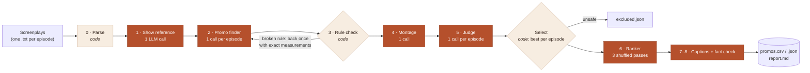

# Thumbstop Engine: finds the best promos in a microdrama screenplay

Thumbstop Engine reads a folder of episode screenplays (one show) and finds the clips worth posting as ads on TikTok, Reels and Shorts. A good clip is 20–60 seconds long, **stops a scroller in the first 3 seconds**, **ends on a cliffhanger**, and **makes sense to someone who has never seen the show**. The clips are then ranked by which to post first.

For every promo you get:
- the **episode and start/end timestamps of every segment**, in play order;
- the **hook** (what the viewer sees in the first 3 s) and the **cliffhanger** (where it cuts);
- **one line on why it works** and **why it's ranked where it is**;
- the judge's scores;
- an optional one-line ad caption that has been fact-checked.

Built for the Kuku AI Generalist Assignment (Problem 1). The input screenplays are Kuku's confidential content and are **not** in this repository.

## Quick start
```bash
pip install -r requirements.txt
cp .env.example .env              # put your API key in .env (free key: build.nvidia.com)
python -m promo_finder.run --show "path/to/show folder" --title "Show Title" --out outputs/myshow
python -m pytest -q               # offline tests with a fake model; set PROMO_TEST_PACK=<show folder> for the data tests
```
- The show folder contains one `.txt` screenplay per episode, in the input-pack format: scenes, then every camera shot, action and line with `Start: (mm:ss.xx) | End: (mm:ss.xx)`.
- `--episodes 1-10` runs on part of a show, and `--no-montage` skips cross-episode promos.
- Every model call is cached in `.cache/`, so an interrupted or repeated run resumes almost for free.

## Swapping models
Every pipeline role has its own line in [`config.yaml`](config.yaml). You can also override one per run with an environment variable, e.g. `PROMO_MODEL_JUDGE=<model id>`.
- **Any OpenAI-compatible endpoint works:** change `api.base_url` and the key variable.
- **On NVIDIA's free tier** (about 40 requests/min, bursts rejected), keep `api.max_concurrent` at 4–5. Raise it on a paid endpoint.
- **Pipeline settings** live under `pipeline:` in the config: promos kept per episode, number of ranking passes, how many promos get captions.

**Default models**, chosen by comparing several free models on the same tasks for each role:

| Role | Model |
|---|---|
| Show reference, promo finder, montage, captions | NVIDIA Nemotron 3 Ultra |
| Judge, ranker | Google Gemma 4 31B |
| Fact check | Mistral Large 4 (low reasoning effort) |

The judge, ranker and fact checker come from **different model families** from the promo finder and caption writer, so no model grades its own work.

## How it works

**What travels between stages:**
- screenplay lines become **timed events with IDs** (`E012-032 · 44.0–46.4 s`);
- the whole series becomes the **show reference** (speaker labels → characters, roles, arcs, secrets);
- each episode becomes **candidates as line-ID ranges**, and code turns them into **segments with timestamps** (episode, start, end);
- the judge adds **scores**, selection keeps the **best per episode**, the ranker adds a **posting order with a reason**, and the last stage adds **fact-checked captions**.

Timestamps are created once, by code, from line IDs, never by a model.

| # | Stage | Who | What it does |
|---|---|---|---|
| 0 | Parse | code | Every screenplay line becomes an event with an ID (`E012-032`), speaker, emotion tags and exact times. Camera changes mark the only legal cut points |
| 1 | Show reference | 1 LLM call | Reads the whole series once: premise, what the title promises a stranger, who is who (screenplay speaker labels are inconsistent), relationships, when each secret is revealed, arcs |
| 2 | Promo finder | 1 call per episode | Sees the episode with every line timed in seconds, plus the next episode's opening. Proposes 0–5 promos **as ranges of line IDs**, never timestamps, with the hook, cliffhanger, why, funnel role, ad-safety rating and its own measured length |
| 3 | Rule check | code (+1 retry) | Converts IDs to timestamps snapped to camera cuts, never mid-line. Enforces 20–60 s, the hook within 3 s, and 1–3 segments. A failing promo goes back to the finder once with exact measurements and computed fixes; otherwise it is dropped, with the reason logged |
| 4 | Montage | 1 call | Joins 2–3 moments from different episodes into one mini-story, built from timed excerpts around the hooks and cliffhangers found in stage 2 |
| 5 | Judge | 1 call per episode | Plays a stranger plus a strict ad reviewer, and sees only the title and that episode's clips. Scores each clip against fixed anchors: hook 30 %, cliffhanger 25 %, standalone 20 %, want-next 15 %, emotion 10 %; −0.15 per "confusion" question; −0.4 for mild ad risk. Sexual content (even implied), gore or torture → **excluded**. The best promo per episode is kept |
| 6 | Ranker | 3 calls | Orders all kept promos for posting by hook power, ending pull, clarity, emotional charge and slate variety. Runs 3× in shuffled order and averages, to cancel position bias |
| 7 | Captions | 1 call per 20 promos | Writes a main and an alt ad line for the top promos, as one batch so the voices vary. Code checks length, character names and spoiler evidence; failing lines get one repair call |
| 8 | Fact check | 1 call per promo | Checks every claim in a caption against the cited script lines. A failing line gets one fix; otherwise it is hidden. The promo itself stays |

About 140 model calls for a 50-episode show.

## Repository layout
```
promo_finder/
  run.py                 pipeline entry point: runs the stages in order, writes the outputs
  core/
    parse.py             screenplay parser and the timed, ID'd renderings shown to the models
    validate.py          hard rules: snapping to camera cuts, 20–60 s, 3-s hook, caption checks
    llm.py               OpenAI-compatible client: model per role, rate limit, retries, cache, call log
    promptlib.py         loads the stage prompts below
  stages/
    reference.py         1  show reference
    propose.py           2–4  promo finder, rule-check repair, montage
    judge.py             5  judge (+ the caption fact check)
    rank.py              5–6  keep the best per episode, final ranking
    captions.py          7–8  captions, caption checks, fact check
  prompts/               one editable system prompt per stage (Markdown) + a README on the design
tests/                   offline tests: parser, rules, full pipeline with a fake model
config.yaml              models per role, API settings, pipeline settings
```

## Outputs (in `--out`)
| File | What it holds |
|---|---|
| `promos.csv`, `promos.json` | Ranked promos: rank, episodes, segment timestamps, hook, cliffhanger, why, why ranked here, caption, judge scores. Then the other valid alternatives |
| `report.md` | A readable report of the ranked promos |
| `excluded.json` | Promos blocked for ad-policy risk, and why |
| `candidates.jsonl` | Every proposal, including those that failed the rules, with reasons |
| `reference.json` | The show reference |
| `summary.json` | Counts, models used, minutes per stage |

## Where it is weaker
- **It works from text only:** beats that are purely visual are under-rated.
- **The judge is an LLM:** its scores are a filter, not ground truth. An editor reviews the ranked list before anything is posted.
- **Free-tier endpoints are slow** (queueing and a ~15-minute cap per call). A full show takes hours there, and minutes on a paid endpoint.
